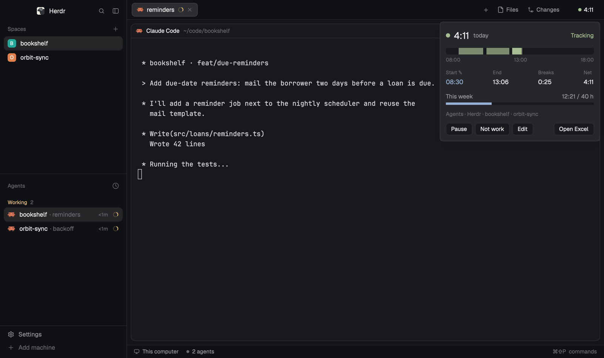
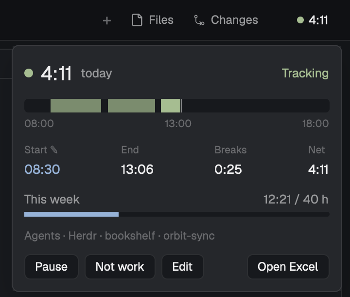
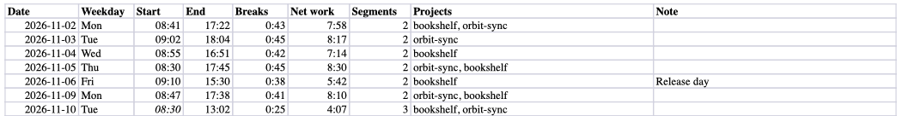

# Corgi · Time tracker for Herdr

<h3 align="center">Your work hours, counted for you. A chip in Herdr shows today's time while you work, and every day lands in an Excel timesheet you can still edit.</h3>

<p align="center"></p>

<p align="center"><sub>✓&nbsp;Free,&nbsp;MIT &nbsp;·&nbsp; ✓&nbsp;Runs&nbsp;locally &nbsp;·&nbsp; ✓&nbsp;herdr-app&nbsp;0.1.14+</sub></p>

Part of [Corgi](https://github.com/saefty/herdr-corgi), a set of Herdr mods that plug into each other.

A chip in your Herdr bar shows how long you have worked today. It counts by itself while you are at the
keyboard and working: in Herdr, in a work app, or while your agents run. Click it for the day's timeline,
your week against its target, and buttons to pause, correct or open the timesheet. Every day lands in an
Excel workbook, one sheet per month, and changes you make in that workbook are kept.

## Use cases

- **The monthly timesheet.** Open the workbook: one row per day with start, end, breaks, net work and the
  Herdr spaces you worked in. A Weeks sheet sums each week against your target hours.
- **You started before you opened the laptop.** Click Edit in the popup and set Start to 07:30. Or change
  the cell in Excel: the tracker reads it back and keeps it from then on, shown in italics.
- **Your agents work while you read docs in a browser.** Agent time counts as long as you are at the
  keyboard, whatever app is in front.
- **A private errand on the work laptop.** Not work drops the running segment and pauses until you press
  Resume. Pause stops counting for the rest of the day.
- **Coffee and meetings away from the desk.** After 2 minutes without input nothing counts, and the segment
  ends at your last input. Gaps under 10 minutes are bridged.
- **Work and private projects in one Herdr.** With a small mod of your own that sorts your spaces into setups,
  only the setups you name count.



## Features

- Samples every 30 s: macOS idle time (`ioreg`) and the frontmost app (`lsappinfo`). It needs no
  accessibility or screen recording permission.
- Work is: you are not idle, and a work app is frontmost, or Herdr is frontmost, or an agent is working.
  With such a mod, Herdr and agents count only in the setups you choose.
- The chip goes into a bar as a block, or floats over any layout.
- The popup shows today's segments on a timeline, start, end, breaks, net, the week's progress, and what
  counted (Herdr, Agents, apps, spaces).
- Edit corrects today's start, end, breaks and note. "Use tracked times" drops the corrections.
- The workbook is written with Python's standard library: a sheet per month, a Weeks sheet, Net and the
  totals as formulas. Labels in English or German.
- Your edits to Start, End, Breaks and Note in the workbook become corrections. Clear a cell to go back to
  the tracked value. Rows you add for days without tracking stay.
- It never writes the workbook while it is open (`lsof`, or Excel's lock file while Excel runs) and retries
  after you close it. The file `timetrack-data/xlsx.hold` stops all writes.
- Data stays on your machine: one JSON line per segment, a file per month, kept for 24 months. No network.
- One background process, which keeps sampling when Herdr quits (then only work apps count). It restarts
  itself when `track.py` changes.



## Works with

The time tracker, [Go to](https://github.com/saefty/herdr-corgi-goto), the
[chat bar](https://github.com/saefty/herdr-corgi-chatbar) and [PR review](https://github.com/saefty/herdr-corgi-pr-review)
are separate mods; each works alone.

- A small mod of your own that sorts your spaces into setups (work, personal) for Go to and the chat bar can
  also tell the tracker which setups count.
- PR review has no link to it. Time you spend reviewing in Herdr counts like any other Herdr time.

## Requirements

- macOS, for `ioreg`, `lsappinfo`, `lsof`, `pgrep` and `open`.
- `python3` on your PATH, standard library only.
- The Herdr app.

On Linux the tracker runs and writes the workbook, but it sees neither idle time nor the frontmost app.
Then only working agents count, also while you are away, and Open Excel fails (it calls macOS `open`). Windows is not
supported.

## Install in three steps

<table>
<tr>
<td align="center" valign="top" width="33%"><h3>1</h3><b>Add the mod</b><br /><sub>With <a href="https://github.com/saefty/herdr-corgi">Corgi</a>: <code>corgi enable timetrack</code>. By hand: copy <code>mods/timetrack</code> to <code>~/.config/herdr-app/mods/</code>. There are no keys to merge.</sub></td>
<td align="center" valign="top" width="33%"><h3>2</h3><b>Place the chip</b><br /><sub>In a bar or floating, with one of the blocks below. The chip starts the tracker.</sub></td>
<td align="center" valign="top" width="33%"><h3>3</h3><b>Check it</b><br /><sub>Corgi does this for you. By hand: <code>herdr-app check ~/.config/herdr-app/mods/timetrack</code>.</sub></td>
</tr>
</table>

Or tell your agent: `Read ~/.config/herdr-app/AGENTS.md, then add this mod: https://github.com/saefty/herdr-corgi-timetrack/tree/main`

By hand, step by step:

1. Copy `mods/timetrack` to `~/.config/herdr-app/mods/`.
2. Place the chip. Herdr's own layouts are read-only, so clone yours first:
   `herdr-app do layout.clone '{"name":"main","as":"my-main"}'`, then edit
   `~/.config/herdr-app/layouts/my-main.json`.

   In a bar: wrap the tab bar block in a row and add the chip beside it.

   ```json
   { "id": "tabs-row", "type": "row", "size": { "px": 42 }, "resizable": false, "children": [
     { "id": "tabs", "type": "block", "window_drag": true, "content": { "mod": "tabs" } },
     { "id": "timetrack", "type": "block", "size": { "px": 76 }, "window_drag": true,
       "content": { "mod": "timetrack", "props": { "part": "bar" } } } ] }
   ```

   Or floating, on the root node (add to its `floating` list if it has one):

   ```json
   "floating": [
     { "id": "timetrack", "content": { "mod": "timetrack", "props": { "part": "float" } }, "edge": "bottom", "align": "start" }
   ]
   ```
3. Run `herdr-app check ~/.config/herdr-app/mods/timetrack`.

The chip starts the tracker. It runs `python3 track.py` from the mod folder, reads and writes
`~/.config/herdr-app/timetrack-data/`, writes the workbook, and runs `ioreg`, `lsappinfo`, `lsof` and
`pgrep`. It makes no network calls.

## Settings

Put the settings you want to change in `~/.config/herdr-app/timetrack.config.json`. They go on top of
the mod's `config.json`, so updating the mod keeps them.

```json
{ "excel_dir": "~/Documents/Hours", "excel_file": "Hours-{year}.xlsx", "sheet_language": "de",
  "work_apps": ["Code", "com.tinyspeck.slackmacgap"], "week_target_hours": 38.5 }
```

| Setting | Default | What it does |
|---|---|---|
| `excel_dir` | `~/Documents/Timesheets` | where the workbook goes |
| `excel_file` | `Timesheet-{year}.xlsx` | its name, one per year |
| `sheet_language` | `en` | `en` or `de`: sheet names, headers, weekdays |
| `work_apps` | editors, Slack, Teams, Zoom | app names or bundle ids that count when frontmost (replaces the list) |
| `idle_seconds` | `120` | no input for this long: not working |
| `gap_minutes` | `10` | shorter gaps are bridged |
| `week_target_hours` | `40` | the week's target in the popup and the Weeks sheet |
| `sample_seconds` | `30` | how often it looks |
| `excel_every_minutes` | `15` | how often the workbook is rewritten while tracking |
| `min_segment_seconds` | `60` | shorter segments are dropped |
| `keep_months` | `24` | older segment files are deleted |

## Customize

Without touching code:

- **Hours, apps and the workbook:** every key in the Settings table, in `timetrack.config.json`. Updates keep it.
- **Where the chip sits:** in a bar beside your tabs, or floating in any corner (`edge`, `align`).
- **Single days:** Edit in the popup, or the Start, End, Breaks and Note cells in the workbook.
- **Only work counts:** a small mod of your own that sorts spaces into setups tells it which ones count.

Changed the code itself? Your edits survive `corgi update`: Corgi merges your version, the old release and the new
one. `corgi diff timetrack` shows what you changed, and `corgi resolve timetrack` helps when an update and your edit
touch the same lines.

## Tests

`python3 mods/timetrack/track.py --selftest`

## For mod authors

How to tell the tracker which spaces count: [PROVIDERS.md](mods/timetrack/PROVIDERS.md).

## License

MIT
