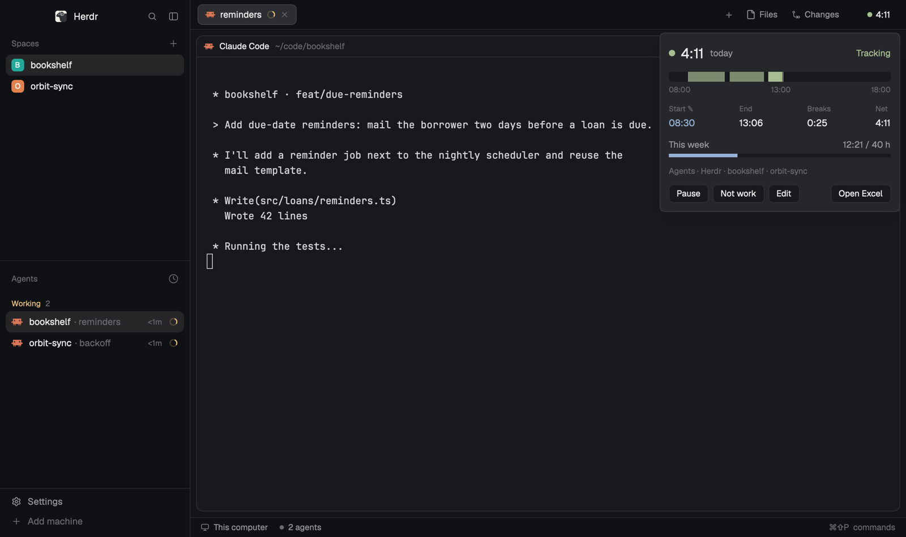

# Corgi · Time tracker

Your work hours, counted for you. A chip in Herdr shows today's time while you work, and every day lands in an Excel timesheet you can still edit.

A small chip in the Herdr window ("● 4:11") shows today's work time. It counts by itself while the person is
at the keyboard and working: in Herdr, in a work app, or while an agent runs. Clicking it opens a popup with
the day's timeline, start, end, breaks, net, the week against its target, and Pause / Resume / Not work /
Edit / Open Excel. A background Python process samples every 30 s and keeps a yearly Excel workbook, and
edits the person makes in that workbook are read back and kept.

**What you see:**

- **The chip**, 26 px high, 6 px side padding, 6 px corners, 12.5 px text: a 7 px round dot and today's net as
  `h:mm` ("–" before the tracker has reported). Tracking: dot `ansi2` (green), text `foreground`. Paused: dot
  and text `muted`. Off or stale: `dim`. Hover: `hover` background. Tooltip "Work time today: tracking",
  "…: paused" or "Work time today".
  - `part: "bar"`: the chip centered in its block, `chrome` background, 1 px `border` bottom border (the look
    of Herdr's tab bar). Meant for a 76 px block beside the tab bar in a 42 px row.
  - `part: "float"`: the chip with 2 px side padding; Herdr draws the floating frame.
- **The popup**, 340 × 320, `popover` background, 12 px padding, 10 px gaps, 12.5 px text, top to bottom:
  - a 9 px status dot, today's net at 20 px semibold, "today" in `muted`; right: "Tracking" in green,
    "Paused", "Not tracking", or "Tracker not running" when status.json is over 180 s old;
  - the timeline: a 14 px `surface` bar, 4 px corners, from 08:00 (or the first segment's hour) to 18:00
    (or now / the last segment), each segment a green bar (closed ones at 70% opacity, tooltip
    "09:02–10:31 · 1:29"), a 1 px line at now; under it three hour ticks in 10.5 px `dim`;
  - Start, End, Breaks, Net as label (10.5 px `dim`) over value (13 px). A corrected field gets "✎" after
    its label and its value in `accent`;
  - "This week" and "12:21 / 40 h" in `muted`, over a 5 px progress bar (`accent`, green once the target is
    reached);
  - the note in `accent` with "✎", else what counted ("Agents · Herdr · bookshelf · orbit-sync") in `dim`;
  - 26 px buttons, 6 px corners, `surface` with `border`: Pause (or Resume, `selected`), Not work (only
    while tracking), Edit; Open Excel on the right (tooltip: the workbook's path);
  - an error line in 11 px: the last failed action in `blocked`, "Excel file: open in Excel; writing after
    it's closed" in `dim`, or "Excel file: writing is on hold".
- **The edit form** (same popup): "Correct 2026-11-10" with "empty = tracked" on the right; Start, End,
  Breaks (h:mm) inputs in a row, Note below (28 px, 6 px corners, `input` border, `background` fill);
  "Edits in the Excel file are kept the same way."; Save, Cancel and, on the right, "Use tracked times".
- **The workbook**, `<excel_dir>/<excel_file>` (default `~/Documents/Timesheets/Timesheet-2026.xlsx`): a sheet
  per month with data ("Nov"), columns Date, Weekday, Start, End, Breaks, Net work, Segments, Projects, Note,
  a frozen header, then a bold Total row; and a Weeks sheet: Week (2026-W46), Monday, Days, Net work,
  Target (h), Delta (h). Corrected cells are italic. With `sheet_language: "de"` the same in German
  (Datum, Wochentag, Beginn, Ende, Pausen, Netto, …; sheets "Mrz", "Wochen").

**How it behaves:**

- A sample counts when the person isn't idle (`idle_seconds`, 120) and: a `work_apps` app is frontmost (name or
  bundle id); or Herdr is frontmost and the shown space's context counts; or an agent with `status ===
  "working"` in a context that counts runs, unless Herdr is frontmost in a context that doesn't count.
  Agents' status (working, blocked, done, idle) matters only as working or not.
- Contexts: without a `goto.context` hook everything counts. With one, `timetrack.contexts` `{count, ignore}`
  decides (PROVIDERS.md). The hook's `current` must count too for Herdr-frontmost time.
- Counting samples less than `gap_minutes` (10) apart form one segment; after a longer gap it ends at its last
  counting sample. Segments under 60 s are dropped; segments crossing midnight are split.
- Pause closes the segment now and stops counting until Resume or the next day. Resume opens a manual segment
  that keeps going on keyboard activity alone. Not work deletes the open segment and pauses.
- Edit: Save sends only the fields that changed; an empty field goes back to the tracked value.
- The workbook is rewritten every 15 min while tracking and after every action, unless it is open (`lsof`
  sees it, or Excel runs and its `~$` lock file exists) or `timetrack-data/xlsx.hold` exists. Before each
  rewrite it is read back: every Start/End/Breaks/Note that differs from what the tracker last wrote becomes
  a correction (`overrides.json`), a cleared cell drops one, and a row for an untracked day is kept.
- Day row: start and end from the first and last segment (or the correction), breaks = span minus tracked
  time, net = end − start − breaks, whole minutes.
- The chip reports facts and rereads status.json every 10 s; nothing animates.

**Built from:** one mod, `mods/timetrack`, `mod.json` `{ "place": "none", "title": "Work time", "overlay":
{ "kind": "popup", "width": 340, "height": 320 } }`.

- `main.js`: `props().part` `"bar"` or `"float"` draws the chip, anything else the popup. A chip runs
  `exec("python3", [track.py, "--facts", json])` and `readTextFile(status.json)` on `cx.timer.every(10000)`,
  and opens the popup with `openOverlay({ mod: "timetrack", kind: "popup", width: 340, height: 320 })`. The
  facts come from `spaces()` (the active one), `agents()` (`status`, `address`, `space`, `space_name`),
  `shared("goto.context")` (`spaces`, `terminals`, `current`) and `shared("timetrack.contexts")`. The popup
  watches the data folder with `watchFolder` and runs `track.py --pause | --resume | --notwork | --set DATE
  field=value…`, and `open <workbook>`. Inputs: gpui-base `InputState`/`Input`, made in `init`.
- `track.py`, Python standard library only: a detached daemon (`--run`, one per data folder via `flock` on
  `daemon.lock`, started by `--facts`/`--spawn`, `--stop`) that samples `ioreg -c IOHIDSystem -d 4`
  (`HIDIdleTime`) and `lsappinfo front` / `lsappinfo info`. Herdr counts as frontmost by bundle id
  `dev.herdr.app` or name "Herdr". Files in `<app home>/timetrack-data/`: `segments-YYYY-MM.jsonl`,
  `state.json` (the open segment), `status.json` (for the views), `herdr.json` (the facts, stale after 90 s),
  `overrides.json`, `written.json`, `tracker.log`. The workbook is SpreadsheetML zipped by hand (`zipfile`),
  read back with `xml.etree`, columns found by their header text in either language. Settings: the mod's
  `config.json`, then `<app home>/timetrack.config.json` on top. `--selftest` runs `test_track.py`.
- `PROVIDERS.md`: the contract for contexts and for mods that draw their own chip.

**Watch out:**

- Never replace the workbook while it's open; when that can't be told, skip the write. Write to a temp file
  in the same folder and rename.
- Read the person's edits back before every rewrite, or the rewrite loses them. Excel saves strings into a
  shared table, renumbers parts and keeps formulas: find sheets through the workbook rels and columns by
  header text.
- A time cell can hold seconds (08:15:20); keep them, don't round a correction to minutes.
- [h]:mm durations: Quick Look shows totals over 24 h modulo 24; Excel shows them right.
- The daemon outlives Herdr: report facts with a timestamp and treat old ones as "Herdr not running".
- A mod can't import another mod's files (`../timetrack/x.js` fails the check), so a bar that draws its own
  chip reports the facts itself (PROVIDERS.md section 3).
- Re-exec the daemon when `track.py` changes, or edits keep running the old code until it is restarted.
- macOS only for sampling: on Linux idle time and the frontmost app are unknown, so only agents count.

**Done when:** `herdr-app check mods/timetrack` passes; `python3 mods/timetrack/track.py --selftest` prints
"all ok"; a layout with `{ "mod": "timetrack", "props": { "part": "bar" } }` shows "● h:mm" in green within
10 s of typing in Herdr, and `timetrack-data/status.json` updates every 30 s; after 2 idle minutes and a
10 minute gap the segment ends at the last input; clicking the chip opens the popup with today's segments;
Edit → Start 07:30 → Save shows "Start ✎ 07:30" and the workbook has 07:30 in italics; changing a Note in
the workbook in Excel and closing it shows the note in the popup and keeps it after the next rewrite; with
`setShared("timetrack.contexts", {count: ["work"]})` and a `goto.context` hook that marks the shown space
`"private"`, Herdr time stops counting.
